# jupedsim-repertoires

Prototype of a behavioural repertoire layer for
[JuPedSim](https://github.com/PedestrianDynamics/jupedsim): agents keep a
behavioural state (for example queueing or overtaking), perceive and
remember their surroundings, and a replaceable selector decides when they
switch behaviour. JuPedSim computes the movement.

The first application is the entrance experiments of Sieben & Postmes
(scenario 2C120). Behavioural assumptions still change, so the layer is
developed here and not inside JuPedSim. Once the interface is stable we
decide whether it moves into JuPedSim or stays a companion package.

## Layout

| Path | Contents |
|---|---|
| `src/jupedsim_repertoires/` | Repertoire layer: behavioural state, perception and memory, decision scheduling, selector interface, run logs |
| `src/repertoire_examples/` | Experiments: entrance geometry, queueing and overtaking repertoires, rule selector, 2C120 scenario |
| `scripts/` | Run the corridor demo, the entrance example and 2C120 |
| `docs/` | Model note, scorecard, figure scripts and the talk (Slidev) |
| `tests/` | `layer/` for the repertoire layer, `examples/` for the experiments |

Behavioural hypotheses stay here. Missing general simulation capabilities
go upstream into JuPedSim.



Only the scenarios import `jupedsim`. The layer calls the simulation object
it is given; the calls are listed in `docs/model.md`. The source of the
figure is `docs/figures/dependencies.html`.

## Setup

```sh
uv sync
uv run pytest
```

JuPedSim is pinned to a master commit in `pyproject.toml`, because
WarpDriver and the agent state interface are not in a release yet. `uv sync`
builds it from source. This needs CMake, a C++20 compiler and Rust 1.88 or
newer. On macOS, use Apple clang:

```sh
CC=/usr/bin/cc CXX=/usr/bin/c++ uv sync
```

## Slides

The talk lives in `docs/slides` (Slidev) and is published from the
`gh-pages` branch: <https://chraibi.github.io/jupedsim-repertoires/>.

```sh
cd docs/slides && npm ci && npx slidev build --base /jupedsim-repertoires/
```

## Reproducing the scorecards

```sh
uv run python docs/scorecard.py experiment docs/scorecards/experiment.json --data 2C120.txt
uv run python docs/scorecard.py cfsm-v2 docs/scorecards/v2_cfsm-v2.json --data 2C120.txt --seeds 5
```

`--data` is the PeTrack trajectory file of 2C120 (the combined file of
cameras 5 and 6). A run that reaches the 300 s limit before everyone has
left is marked `"completed": false`, with the agents still inside and the
entries not yet added.
Each run writes a JSON Lines log next to its card (about 600 MB per run);
logs are not committed.

## Extracting situations

```sh
jps-repertoires extract-situations run.jsonl --output out/situations.jsonl [--sample N --seed S] [--overwrite]
```

This writes `situations.jsonl`, `situations.labels.jsonl` and
`situations.manifest.json`. The manifest is written last; an export
without a manifest is incomplete, and its checksums should be checked
before the files are used. `--sample` is uniform over decision requests,
not over people or time; without `--seed` it uses seed 0.

## History

The code started on the JuPedSim branch `behavioural-repertoires`
(fork `chraibi/jupedsim`); its history was carried over.
