# Behavioural repertoires in JuPedSim

## Simulated pedestrians that decide *what kind of behaviour* to engage in

30 October 2026 &nbsp;|&nbsp; Mohcine Chraibi &nbsp;|&nbsp; Institute for Advanced Simulation, IAS-7 Civil Safety Research

Concept: Sieben &amp; Postmes (2025), *Royal Society Open Science* 12, 241561

<!--
The point of the talk: a pedestrian simulation in which social behaviour is a
choice, separate from the physics of walking.
-->

---
layout: fzj-section
---

# Version 0

Queueing and overtaking

---

# Model

## Two levels: what am I doing, and how do I move?

<div class="grid grid-cols-2 gap-10 mt-6">
<div>

**What am I doing right now?**
Queueing behind someone, or overtaking them.
→ the *behavioural repertoire*, chosen from what the person sees and
remembers.

**How do I move?**
Step towards a target at a desired speed without bumping into others.
→ the existing JuPedSim *movement model*.

</div>
<div>

- The repertoire decides **where to go next** (a temporary target) and
  **how fast**.
- The movement model turns that into steps.
- The new positions change what everyone sees, and the cycle repeats every
  0.1 s.

</div>
</div>


<div class="small" style="text-align:center; margin-top:0.2rem">
The selector decides <b>what</b> to do; repertoire control decides <b>where to step next and how fast</b>.
</div>

---

# Seeing

## Who is in view, and how far each person is from the entrance

<div class="cols" style="grid-template-columns: 1fr 1.25fr; gap:1.2rem">
<div>
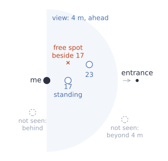
</div>
<div>

- People within **4 m**, in the **half-plane ahead** (towards the entrance).
- For each of them: position and **progress** towards the entrance $E$,
$$
p_j(t) = -\lVert \mathbf{x}_j(t) - E \rVert ,
$$
  larger $p$ is closer to the entrance.
- The person I am overtaking stays in view even when they fall behind me.
- The walls are known: they decide where there is room to step aside.

<div class="small" style="margin-top:0.8rem">
In the example: 17 is standing just ahead, 23 is further on, and there is
a free spot beside 17. The two grey people are not seen.
</div>

</div>
</div>

---

# Remembering

## What each person saves over the last 8 s

<div class="cols" style="margin-top:0.6rem">
<div>

### Saved

- **Own progress**, every 0.1 s
- **Who passed me, and when**: only if I saw them behind me and then ahead
  of me, without losing sight of them
- **Whether the person I follow has left**

No positions or intentions of others are stored.

</div>
<div>

### Used for the decision

- Progress gained in the last 4 s:
$$
\Delta p_i(4\,\text{s}) = p_i(t) - p_i(t - 4\,\text{s})
$$
- Number of people who passed me in the last 6 s: $N_i(6\,\text{s})$

<div class="small" style="margin-top:0.8rem">
In the example: moved 0.1 m in the last 4 s; 2 people passed in the last
6 s.
</div>

</div>
</div>

---

# Acting

## A behaviour gives a target point and a speed; the movement model walks there

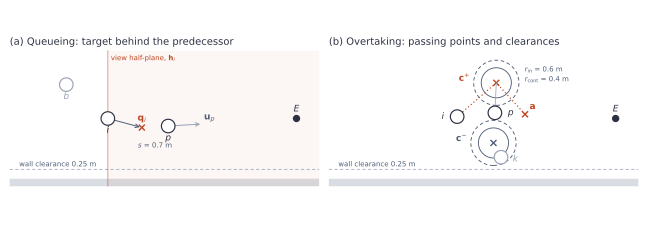

<div class="cols" style="margin-top:0.4rem">
<div>

**(a) Queueing**: target 0.7 m behind the person ahead; stand still once
there.

</div>
<div>

**(b) Overtaking**: first **step aside** to a free spot $c$ beside them,
then **pass ahead** to a point $a$ 0.8 m in front of them.

</div>
</div>

<div class="small" style="margin-top:0.4rem">
Which behaviour a person is in is chosen by the selector from what they
see and remember, every 2 s or after an event (next slides).
</div>

---

# Example 1: overtaking

## No explicit overtaking is coded

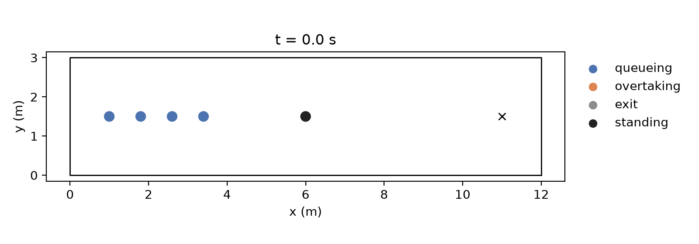

<div class="grid grid-cols-2 gap-8 mt-2 text-sm">
<div>

1. Four people arrive and **queue** behind the person standing still.
2. Nobody moves for a few seconds: they are **stuck**.
3. The first one sees room on the side and **overtakes**.
4. The next one tries too, finds the gap taken, **gives up**, and tries
   again later.

</div>
<div>

<div class="box">

- **Sees** the standing person ahead, and a free spot beside them
- **Remembers** no progress for 4 s
- **Acts**: switches from queueing to overtaking

</div>

<div class="small">
blue: queueing · orange: overtaking · grey: heading to the exit · black: standing person
</div>

</div>
</div>

---

# How does someone queue?

## Follow the nearest person ahead

<div class="text-xl mt-6">

$$
\text{target} \;=\; \underbrace{\mathbf{x}_p}_{\text{person ahead}}
\;-\; \underbrace{0.7\,\text{m}}_{\text{spacing}}\;\mathbf{u}_p
$$

</div>

<div class="grid grid-cols-2 gap-10 mt-8">
<div>

**Who is ahead?** The nearest person I see who is at least 0.2 m closer to
the entrance:

$$
p = \arg\min_j \lVert \mathbf{x}_j - \mathbf{x}_i \rVert
\quad\text{with}\quad p_j > p_i + 0.2\,\text{m}
$$

Nobody ahead → walk to the entrance.

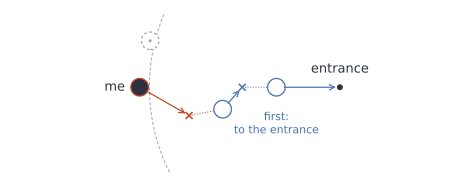

</div>
<div>

**Where to go?** 0.7 m behind that person, on the line from them to the
entrance ($\mathbf{u}_p$), at 2.5 m/s; the movement model slows down when
there is no room.

**Pick again** when that person leaves, is no longer seen, or is no longer
0.2 m ahead.

There is no line in the model: a queue is a chain of people each following
the one ahead.

</div>
</div>

---

# When does someone start to overtake?

## Incentive and opportunity

<div class="text-xl mt-6">

$$
\text{overtake} \;=\; \underbrace{\text{incentive}}_{\text{a reason}}
\;\wedge\; \underbrace{\text{opportunity}}_{\text{a free spot}}
$$

</div>

<div class="grid grid-cols-2 gap-10 mt-8">
<div>

**Incentive**: either

- I gained less than 0.3 m in the last 4 s (*stuck*), or
- at least 2 people passed me in the last 6 s (*others are going ahead*).

$$
I_i = \bigl[\Delta p_i(4\,\text{s}) < 0.3\,\text{m}\bigr] \vee \bigl[N_i(6\,\text{s}) \ge 2\bigr]
$$

</div>
<div>

**Opportunity**: a spot 0.8 m beside the person ahead, clear of walls, with
nobody within 0.6 m.

An incentive but no spot → keep queueing, and the log records
*withheld*.

Starting needs **more room (0.6 m)** than continuing **(0.4 m)**, so small
sideways movements of neighbours do not end an overtake at once.

</div>
</div>

---

# Repertoire-switching

## Queue, overtake, complete or abandon, queue again

<div class="cols" style="grid-template-columns: 2.2fr 1fr; align-items:center">
<div class="small">

**Step aside**: walk to the free spot beside the person ahead
(c in the figure on the Acting slide).

**Pass ahead**: walk to a point 0.8 m in front of them (a).

</div>
</div>

- **Abandon** when the free spot disappears, the person being passed is lost
  from view, or the overtaker makes no progress for 2 s.
- **Complete** when the overtaker is 0.3 m further on than the person
  passed.
- Within 1 m of the entrance, control goes back to JuPedSim.

---
layout: two-cols-header
---

# Bottleneck example

## 40 people at a 1 m wide entrance

::left::

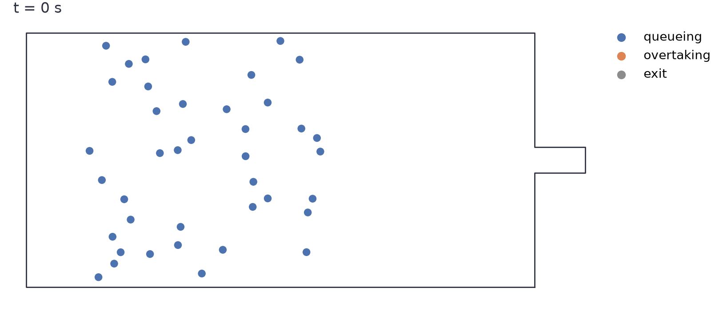

::right::

Three runs of 90 people, by the room needed to start an overtake:

| | 0.4 m | 0.6 m |
|---|---:|---:|
| overtakes started | 639 | 215 |
| completed | 209 | 134 |
| given up within 0.5 s | 198 | 7 |

<div class="small" style="margin-top:1rem">
The thresholds are assumptions, not yet fitted to the experiments.
</div>

---

# Two different operational models

## The repertoire layer does not depend on the movement model

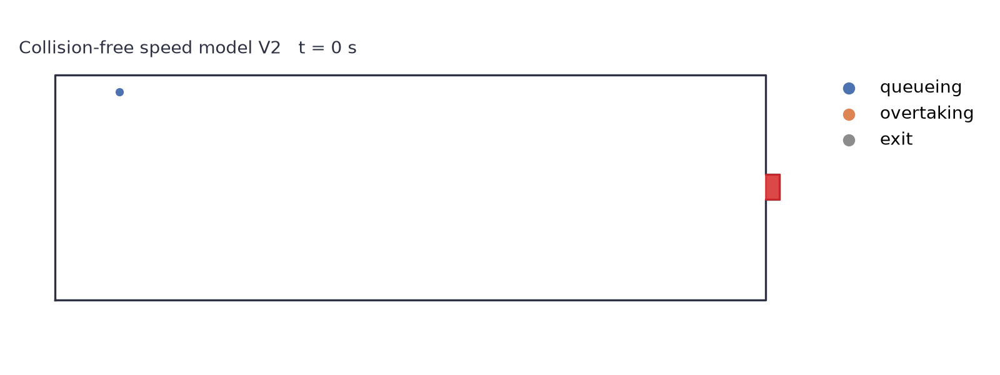
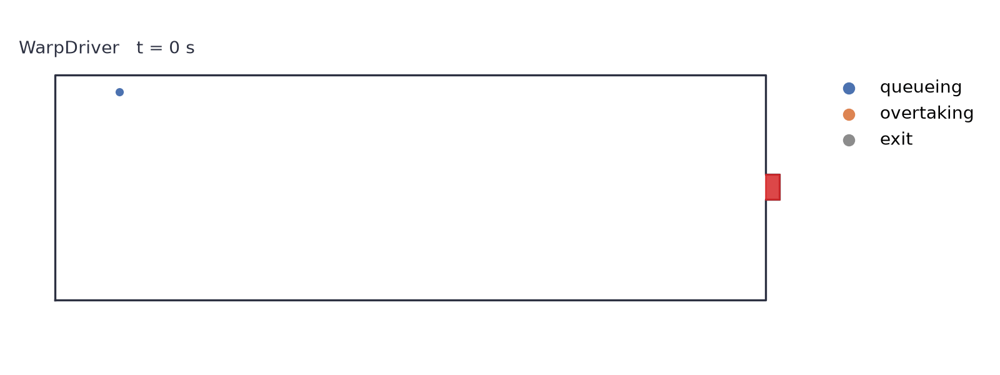

<div class="small" style="margin-top:0.6rem">
Experiment 2C120 (87 people, door closed until 90.5 s), same arrivals and rules.
A movement model only has to accept a target and a desired speed.
Exit speed 0.8 m/s, measured in the doorway.
Top: collision-free speed model V2. Bottom: WarpDriver.
</div>

---

# How to score model progression

## The same three measures for every version, against experiment 2C120

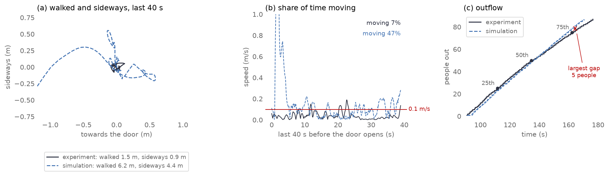

<div class="cols3" style="margin-top:0.5rem; font-size:0.8rem">
<div>

**(a) Door closed**: distance walked and the part of it across the direction to
the door, per minute, in the last 40 s before the door opens.

</div>
<div>

**(b) Share of time moving**: fraction of time faster than 0.1 m/s. People
mostly stand; agents in version 0 shuffle.

</div>
<div>

**&#40;c&#41; Outflow**: when the 25th, 50th and 75th person and the last are out,
and the largest gap between the two curves.

</div>
</div>

<div class="small" style="margin-top:0.3rem">
Example: one person and the agent replaying them, version 0, V2.
</div>

---

# Version 0: scorecard

## 2C120 with the rules, compared with the experiment

| | Experiment | V2 | WarpDriver |
|---|---:|---:|---:|
| **Door closed** walked (m/min) | 1.9 | 4.0 | 17.6 |
| sideways (m/min) | 1.1 | 3.1 | 13.9 |
| share of time moving | 0.05 | 0.26 | 0.68 |
| **Outflow** 25th / 50th / 75th out (s) | 112 / 135 / 162 | 113 / 135 / 159 | 100 / 110 / 124 |
| last out (s) | 176 | 170 | 134 |
| largest gap (people) | – | 5 | 38 |
| **Overtakes** completed / abandoned | – | 71 / 41 | 122 / 47 |

<div class="small" style="margin-top:0.6rem">
Medians over people; one run per model. Door closed: the last 40 s before the
door opens, positions smoothed over 1 s, moving = faster than 0.1 m/s.
Largest gap: largest difference in the number of people out at any time.
Produced by <code>docs/scorecard.py</code>.
</div>

---
layout: fzj-section
---

# Version 1

Add repertoire "Waiting" 


---

# Version 1: what changed

## Standing in a queue is not the same as being stuck

<div class="cols" style="grid-template-columns: 1.3fr 1fr; gap:1.4rem; margin-top:0.4rem">
<div>

Movement per person in the last 40 s before the door opens (V2, median):

| | Experiment | Version 0 | Version 1 |
|---|---:|---:|---:|
| walked (m/min) | 1.9 | 4.0 | 0.8 |
| sideways (m/min) | 1.1 | 3.1 | 0.5 |
| share of time moving | 0.05 | 0.26 | 0.00 |

<div class="small" style="margin-top:0.6rem">
Version 0: the target followed every small shift of the person ahead, so
corrections passed down the queue.
</div>

</div>
<div>

<div class="box">

**Keep the place**: a standing person stays put until the gap to the
person ahead exceeds 0.7 + 0.4 m.

</div>

- The 0.4 m was chosen with an earlier measure that included walking in.
  Over the last 40 s, version 1 agents stand still more than people do.
- Still open: the rules read waiting at a closed door as *stuck*. Expected
  waiting and unexpected delay need to be told apart.

</div>
</div>

---

# Version 1 in 2C120

## Light blue: queueing and keeping the place

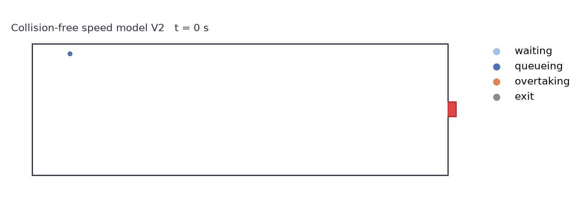
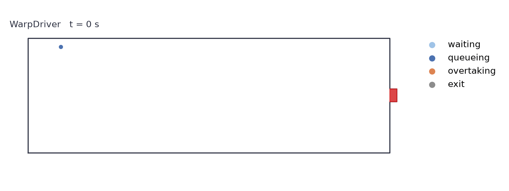

<div class="small" style="margin-top:0.6rem">
Same arrivals, rules and exit speed as version 0. Only queueing changed.
Top: collision-free speed model V2. Bottom: WarpDriver.
</div>

---

# Version 1: scorecard

## Better or worse than version 0?

| | Experiment | V2: v0 → v1 | WarpDriver: v0 → v1 |
|---|---:|---:|---:|
| **Door closed** walked (m/min) | 1.9 | 4.0 → **0.8** | 17.6 → **7.0** |
| sideways (m/min) | 1.1 | 3.1 → **0.5** | 13.9 → **4.4** |
| share of time moving | 0.05 | 0.26 → **0.00** | 0.68 → **0.33** |
| **Outflow** 25th / 50th / 75th out (s) | 112 / 135 / 162 | 113 / 135 / 159 → 114 / 139 / 164 | 100 / 110 / 124 → **107 / 122 / 144** |
| last out (s) | 176 | 170 → **178** | 134 → **156** |
| largest gap (people) | – | 5 → 5 | 38 → **18** |
| **Overtakes** completed / abandoned | – | 71 / 41 → 107 / 64 | 122 / 47 → 129 / 50 |

<div class="small" style="margin-top:0.4rem">
<b>Bold</b>: closer to the experiment than version 0. Movement while the door is closed improves for both
models, but V2 agents now stand still more than people; the outflow of V2 stays as close as
before; WarpDriver is still too fast.
V2 completes more overtakes in version 1; the reason is not yet clear.
</div>

<div class="small" style="margin-top:0.6rem">
Medians over people; one run per model. Door closed: the last 40 s before the
door opens, positions smoothed over 1 s, moving = faster than 0.1 m/s.
Largest gap: largest difference in the number of people out at any time.
Produced by <code>docs/scorecard.py</code>.
</div>

---
layout: fzj-section
---

# Version 2

Walking speeds of everyday people

---

# Version 2: what changed

## Each person walks at their own speed

<div class="cols" style="grid-template-columns: 1fr 1.2fr; gap:1.4rem; margin-top:0.4rem">
<div>

<div class="box">

**Own desired speed**: each person draws a speed from 0.8 to 1.6 m/s
(1.2 ± 0.4) and keeps it while queueing and overtaking.

</div>

- Before: 2.5 m/s queueing and 3.5 m/s overtaking, for everyone.
- People run in during the first ~12 s of the experiment. We do not model
  this.
- The draw is random, so each model is run with five draws (seeds).

</div>
<div>

The draw decides whether the queue settles. Walked in the last 40 s
(m/min, median over people; experiment 1.9):

| Seed | 0 | 1 | 2 | 3 | 4 |
|---|---:|---:|---:|---:|---:|
| V2 | 9.8 | 2.2 | 0.4 | 0.4 | 3.9 |
| WarpDriver | 5.5 | 4.7 | 4.1 | 4.8 | 5.5 |

<div class="small" style="margin-top:0.6rem">
With seed 0, overtakes at the back of the queue keep opening gaps that
invite more overtakes. One run cannot score a version.
</div>

</div>
</div>

---

# Version 2 in 2C120

## The run with the median seed of each model


<div class="small" style="margin-top:0.6rem">
Same arrivals, rules, waiting and exit speed as version 1. Only the desired
speeds changed. Top: collision-free speed model V2 (seed 1). Bottom:
WarpDriver (seed 3).
</div>

---

# Version 2: scorecard

## Better or worse than version 1?

| | Experiment | V2: v1 → v2 | WarpDriver: v1 → v2 |
|---|---:|---:|---:|
| **Door closed** walked (m/min) | 1.9 | 0.8 → **2.2** <span class="small">(0.4–9.8)</span> | 7.0 → **4.8** <span class="small">(4.1–5.5)</span> |
| sideways (m/min) | 1.1 | 0.5 → **1.5** <span class="small">(0.2–5.7)</span> | 4.4 → **3.4** <span class="small">(2.8–3.7)</span> |
| share of time moving | 0.05 | 0.00 → **0.08** <span class="small">(0.00–0.39)</span> | 0.33 → **0.26** <span class="small">(0.20–0.31)</span> |
| **Outflow** 25th / 50th / 75th out (s) | 112 / 135 / 162 | 114 / 139 / 164 → 115 / 141 / 167 | 107 / 122 / 144 → **110 / 131 / 154** |
| last out (s) | 176 | 178 → 180 | 156 → **167** |
| largest gap (people) | – | 5 → 6 | 18 → **9** |
| **Overtakes** completed / abandoned | – | 107 / 64 → 90 / 79 | 129 / 50 → 100 / 73 |

<div class="small" style="margin-top:0.4rem">
<b>Bold</b>: closer to the experiment than version 1. Movement while the door is closed comes close
to the experiment for V2 in the median, but depends strongly on the seed; the V2 outflow becomes
slightly slower. WarpDriver improves on every measure and hardly depends on the seed.
</div>

<div class="small" style="margin-top:0.6rem">
Version 2: medians over five speed seeds, range in brackets; version 1: one run (no random speeds).
Door closed: the last 40 s before the door opens. Produced by
<code>docs/scorecard.py --seeds 5</code>.
</div>

---
layout: fzj-section
---

# Next

Selectors and further repertoires

---

# What is a selector?

## A replaceable decision rule that maps perception and memory to a behaviour

<div class="box accent" style="margin-top:0.4rem; text-align:center">

sees + remembers + doing &nbsp;→&nbsp; **selector** &nbsp;→&nbsp; *overtake person 17 on the left*

</div>

<div class="cols" style="margin-top:0.4rem">
<div>

### Rule selector (today)

A fixed switch, the same for everyone:

```text
incentive = stuck or passed_by_others

if incentive and free_spot:
    overtake
elif incentive:
    keep queueing      # overtaking withheld
else:
    keep queueing
```

Deterministic: the same situation always gives the same behaviour.

</div>
<div>

### Contextual selector (possible)

A contextual decision model, such as Jev (TypeSafe AI) or Laya, takes **a
description of the situation and a fixed set of choices**, then returns a
choice with probabilities:

```text
input:    "I have waited 12 s, people ahead are also
           stationary, and two people passed me."
choices:  queueing, overtaking
output:   queueing 0.8, overtaking 0.2
```

Our code then applies the selected behaviour; JuPedSim calculates the
movement. The probabilities express the model's judgement; they are not
measured probabilities of human behaviour.

</div>
</div>

---

# Three selectors, one interface

## Same perception, memory, movement and feasibility check; only the decision differs

| Selector | What it is | Status |
|---|---|---|
| **Rules** | Fixed thresholds on progress and being passed | in use |
| **Transition model** | Probability of *leaving* the current behaviour per second, depending on waiting time, progress, being passed, free space and how long the behaviour has lasted | planned; to be fitted to the 2C120 codings |
| **Contextual model** | Jev or Laya chooses from the same repertoires, given a described situation | planned; optional dependency, not part of JuPedSim |

<div class="cols" style="margin-top:0.6rem">
<div>

### A probability needs a time interval

The selector is asked every 2 s. "Overtaking 0.2" per question means that
after 20 s, $1 - 0.8^{10} \approx 89\,\%$ of agents have tried to overtake.

A rate $\lambda$ per second does not depend on how often we ask:
$P(\text{leave within } \Delta t) = 1 - e^{-\lambda \Delta t}$.

</div>
<div>

### What stays ours

- When the selector is asked, and what it remembers.
- Which behaviours it may choose.
- Whether a passing route exists (JuPedSim).
- A plausible answer from a language model is not evidence of how people
  behave.

</div>
</div>

<div class="small" style="margin-top:0.4rem">
The reusable part for JuPedSim is the repertoire and selector interface; the selectors are
examples built on it.
</div>

---

# What would a contextual selector do?

## Our expectation, to be tested: we have not yet run Jev or Laya

<div class="cols" style="margin-top:0.4rem">
<div>

### Possible

- **Can combine more contextual information**, but only what we supply.
  A rule selector given the same observations and memory could use it too.
- **Can produce different choices when sampled.** That is variability
  between decisions, not stable differences between people; those would
  need agent characteristics or histories.
- **Replaces explicit switching thresholds with a model-based judgement.**
  Observation windows, available behaviours, instructions and feasibility
  thresholds remain our choices.

</div>
<div>

### To check

- Whether it predicts the observed choices and transitions better than
  explicit rules.
- Whether the returned distribution is stable, and whether small wording
  changes alter it. A recorded run can always be replayed.
- **Same feasibility check for every selector**: overtaking needs a free
  passing point, whichever selector chose it.

</div>
</div>

<div class="box accent" style="margin-top:0.8rem">
A probability of 0.2 for overtaking is not evidence that 20 % of people
overtake. We compare fixed behaviour, rules, a transition model and a
contextual model such as Jev or Laya with the experiments.
</div>

---

# First test: same situations, three selectors

## Offline, before a contextual selector drives the simulation

<div class="cols" style="margin-top:0.4rem">
<div>

### How

1. Take situations from recorded runs: what the agent sees and remembers,
   and what it is doing.
2. Give each situation to the rules, the transition model and a
   contextual model.
3. Use the most probable choice, without sampling.
4. Compare where the choices differ, and whether the differences survive
   harmless changes in wording.

</div>
<div>

### Situations

| What the agent perceives | Case |
|---|---|
| Nobody nearby advances | expected waiting |
| The queue moves now and then | intermittent progress |
| One person passes | isolated passing |
| Others keep passing while my part stands | sustained overtaking |

</div>
</div>

<div class="box accent" style="margin-top:0.6rem">
Does contextual interpretation explain when people stay in a queue and when
they leave it? The benefit has to show in these decisions, not in a calmer
animation.
</div>

**Two limits.** A selector cannot calm restless queue execution: agents that
chase shifting targets keep moving even if every choice is "queueing". And
sampling a fresh choice at every decision adds switching by itself.

<!--
Two limits. A selector cannot calm restless queue execution: if agents
chase shifting targets, they move even when every decision is "queueing".
And sampling a fresh choice at every decision adds switching by itself,
so the first comparison uses the most probable choice and keeps the
existing decision schedule and commitment.
-->

---

# Beyond queueing and overtaking

## A repertoire is a small, self-contained piece

<div class="grid grid-cols-2 gap-10 mt-4">
<div>

| Part | Meaning |
|---|---|
| **name** | e.g. `queueing` |
| **requires** | what the movement model must allow (set a target, set a speed) |
| **enter** | what changes when the behaviour starts (whom to follow) |
| **control** | every 0.1 s: where to go, how fast, or "done" |

New repertoires plug in without changing the rest.

</div>
<div>

Candidates from the ethogram:

- **standing aside**: leave the queue and wait beside it
- **following a companion**: anchor = the companion, not the queue
- **giving way**: let a specific person pass
- **joining a group**: decisions taken for a pair or group (the interface is
  ready; the group rules are not written yet)

</div>
</div>

---
---

# What we still need from psychology

- When is waiting **expected**, and when does it feel like being **stuck**?
- What makes people **start overtaking**, and how long do they wait first?
- How often do overtaking attempts **fail**?
- Which **other behaviours** should come next?
- **Codings of 2C120**: who overtook whom, and when
